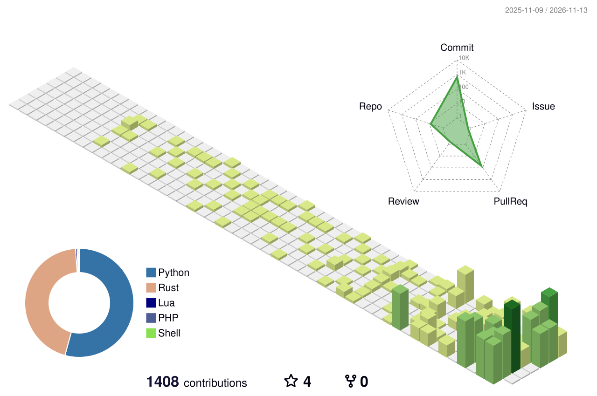

### Hi, I'm Florian 🐙

Systems engineer from Salzburg, Austria. I work with Linux, Windows, Proxmox and networks, and I like turning repetitive ops work into small tools, mostly in Rust and Python.  
[**→ blog**](https://miloo.at)
<picture>
  <source media="(prefers-color-scheme: dark)" srcset="profile-3d-contrib/profile-night-rainbow.svg">
  
</picture>
